# Tracerfall  *(formerly Soldat Reborn)*

**Tracerfall** is a fast 2D jetpack run-and-gun shooter built in Godot 4.7: a spiritual successor to the classic
**Soldat**. Jet boots, bunny-hop momentum, ragdoll gibs, grenades, vehicles and online multiplayer,
made with Soldat's own art and sound (CC BY 4.0) and an animated skeletal soldier. It covers everything
the classic had and more, with most of Soldat 2's feature list folded in.

[**Download the latest release**](https://github.com/Predator04/Soldat-Reborn/releases/latest) (Windows `.exe`, Android `.apk`) ·
[Changelog](CHANGELOG.md) · [Roadmap](ROADMAP.md) · [Open issues](https://github.com/Predator04/Soldat-Reborn/issues)

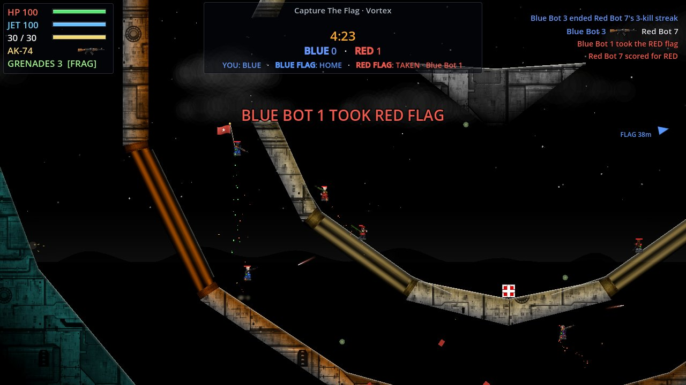

| | |
|---|---|
| 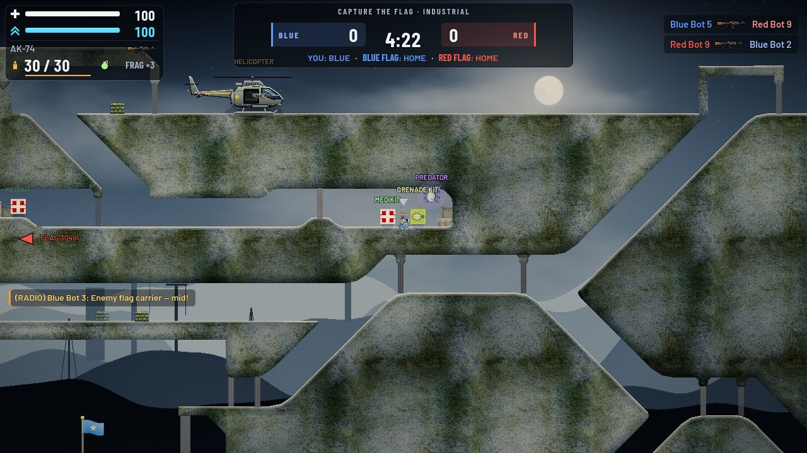 | 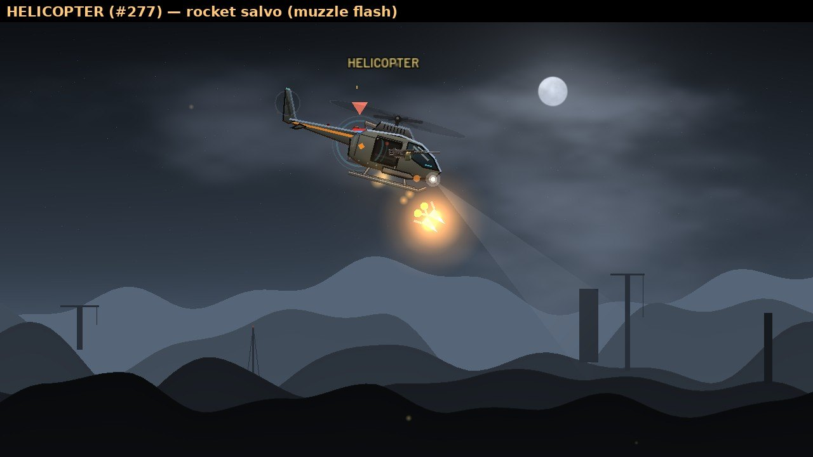 |
| 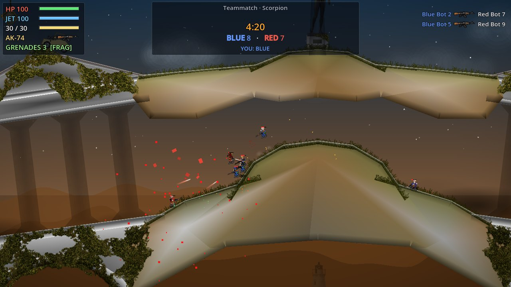 | 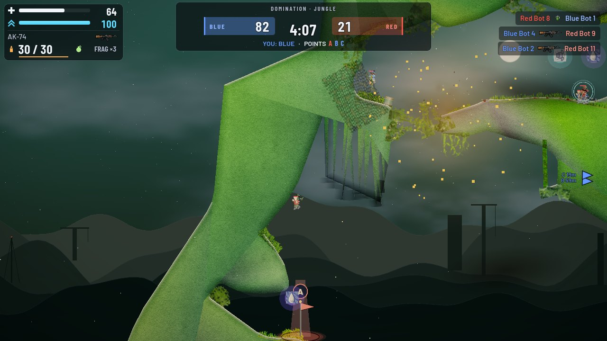 |
| 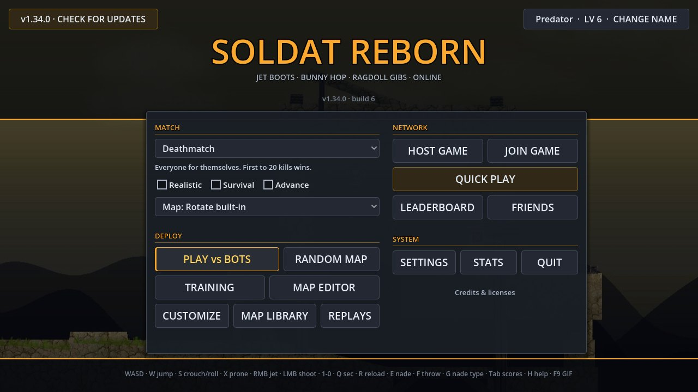 | 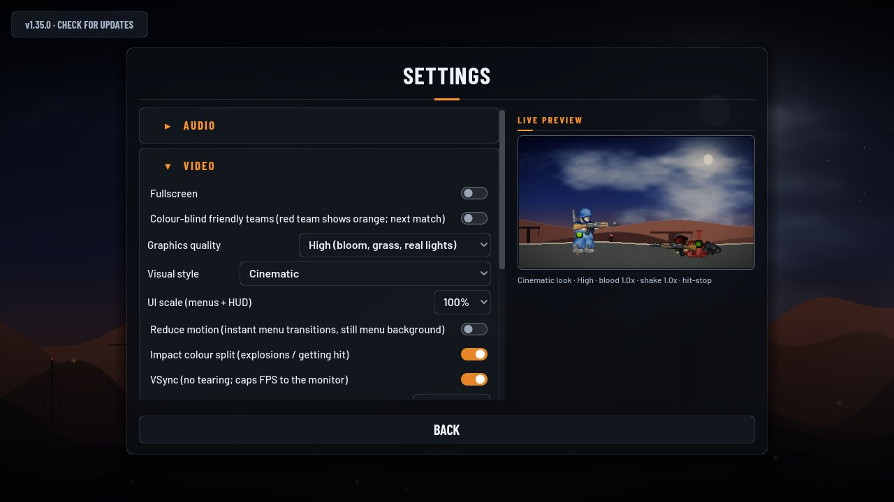 |

<sub>Real frames from the v1.35 build ( bot matches, 1280×720, rendered in software GL — on a GPU it looks the same, only smoother).</sub>

### What's new in 1.36 — Ultra HD

- **New soldiers** — redrawn from scratch in ultra HD on the same skeleton, animations and hit boxes: modern proportions, a helmet with a glowing team-colour visor, plate carrier, pads, boots, gloves, a real jetpack, and every cosmetic redrawn. *Classic* soldiers stay in Settings → Video → Soldier look.
- **Ultra HD guns** — all 16 weapons and the grenades repainted at 6x: machined wear, wood grain, stippled grips, markings. Same bullet spawn.
- **HD terrain** — 12 detailed materials (rock, sand, metal, wood, brick, snow, ice …) with painted grass lips, snow caps and icicles, and backgrounds that match each map's theme.
- **Dynamic lighting** (High) — muzzle flashes, explosions, rockets and jetpack burns light soldiers, guns and terrain by direction; soldiers cast soft contact shadows.
- The next-map vote now only appears in the last two minutes of a match.

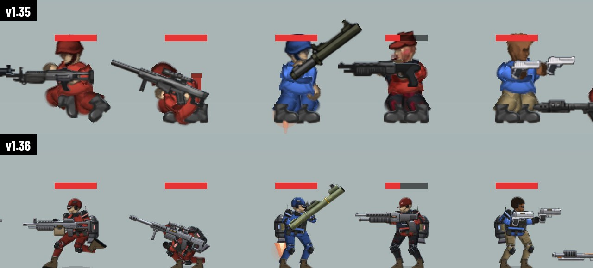
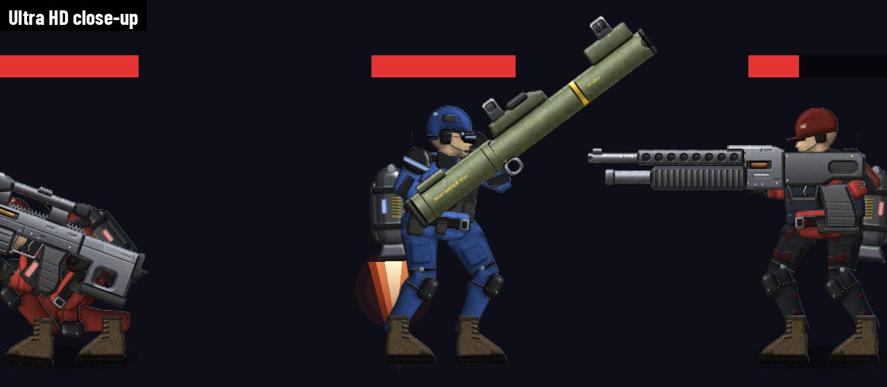
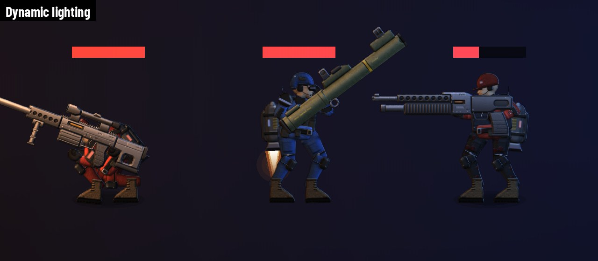
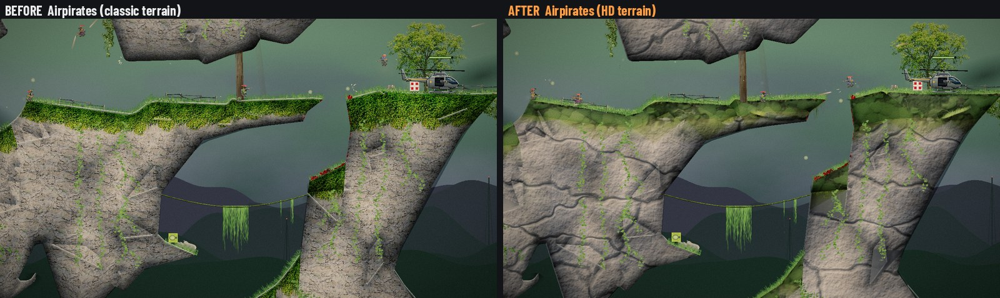
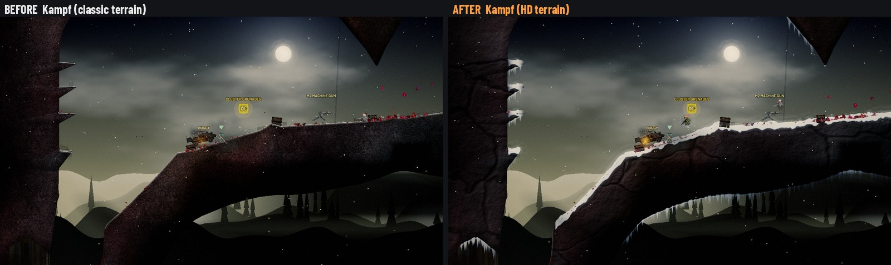
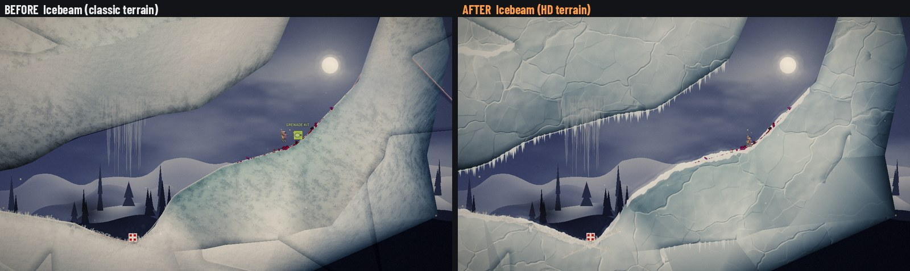
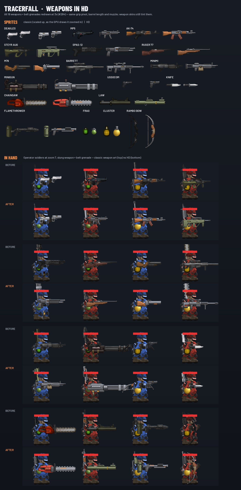

### What's new in 1.35 — Tracerfall

The game has a new name and a full visual overhaul (all cosmetic: physics, netcode and gameplay are unchanged and tested bit-for-bit):

- **Cinematic look** — animated moonlit sky, fogged parallax hills with distant ruins, a filmic grade, real light from muzzle flashes and explosions, rim-lit soldiers. *Classic* look still in Settings → Video.
- **Gore & effects** — soldiers break into their own body parts, blood sprays, arcs and stays on walls and floors; sparks, brass, debris, smoke and heat haze — all from fixed pools, so heavy fights never create nodes.
- **Feel** — squash & stretch, weapon kick, hit flash, smooth screen shake, a freeze-frame on your kills (the match keeps running underneath).
- **New menus & HUD** — one design language, animated screens, a live preview in Settings, UI scale and Reduce motion options.
- **Vehicles** — detailed animated buggies and tanks with damage stages and burning wrecks, and a new **helicopter** (pilot rockets + door gunner) on the 15 biggest maps.
- **Smoother maps** — rounded terrain corners on all 99 classic maps, in the drawing and in the ground you run on.
- **Movement course**, **menu news line**, **weekly featured mode on the official server**, and **server-side cheat checks**.

**Before → after** (left half is v1.34, right half is v1.35):

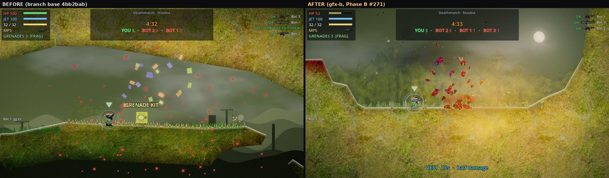
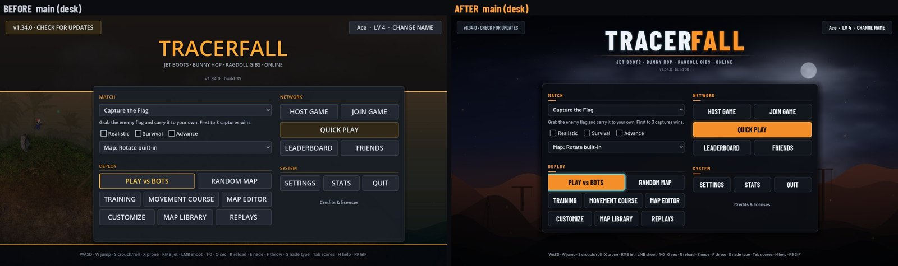
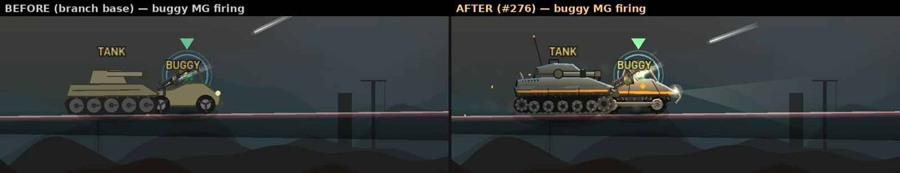
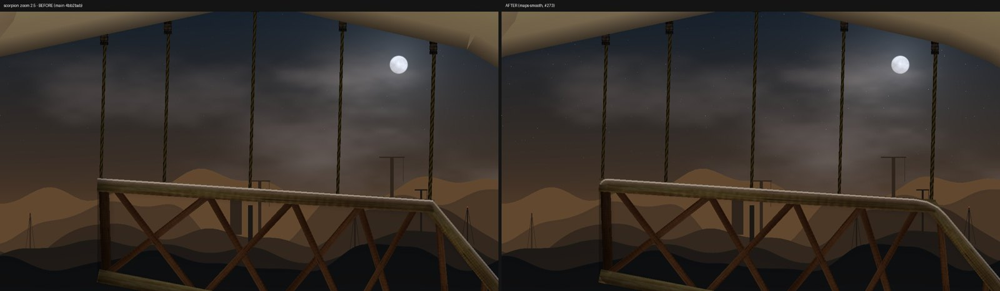

## Play online

QUICK PLAY drops you into the best game for your ping and skill level. The **official server** runs
around the clock, and its mode/map rotates weekly. To host your own game, press HOST GAME:
friends join with a short code over the relay, so **no port forwarding** is needed. Anyone can also run
a dedicated server (`--dedicated`; see [CLAUDE.md](CLAUDE.md)).

The host also checks every client: godmode, teleport/speed hacks, impossible health and fake kill
credit are caught on the server (forced death, then a kick).

## Features

- **Movement** — run / bunny-hop / jet boots with fuel, crouch, prone, roll, backflip-friendly physics; tap for a short hop, hold jump for the full leap; prone mid-air drops you faster (prone-cancel). Training ends with a movement course that teaches all of it against the clock (also on the menu as MOVEMENT COURSE)
- **Weapons** — 10 primaries (Deagles, MP5, AK-74, Steyr AUG, Spas-12, Ruger 77, M79, Barrett, Minimi, Minigun) + 4 secondaries (USSOCOM, Knife, Chainsaw, LAW) + Flamethrower, Rambo Bow, Frag/Cluster grenades, M2 stationary gun
- **Game modes** — Deathmatch, Pointmatch, Teammatch, Capture the Flag, Rambomatch, Infiltration, Hold the Flag, **Domination**, **Battle Royale**, **Gun Game** + Realistic/Survival/Advance sub-modes; auto team balance between rounds
- **Map editor** — in-game editor: place platforms, spawns, flags, control points; save/load custom maps; play-test live
- **Procedural maps** — seeded generator with re-roll, produces playable layouts for every mode
- **Classic maps** — 99 original Soldat levels ported from `.pms` with scenery, textured terrain, weather and baked bot navigation (bots play every objective mode on every map)
- **Graphics** — cinematic or classic look, dynamic 2D lights, filmic post-processing, pooled particles and persistent blood, hit-stop and screen shake, three quality presets (Low runs on old PCs and phones)
- **Menus & accessibility** — animated menus, live settings preview, UI scale 85–130 %, Reduce motion, colour-blind team colours, 5 languages
- **Polish** — gestures/taunts, chat, weapon throw/pickup, ceasefire, bink, game modifiers, character customization with unlockables, lo-fi mode, local stats, GIF recording, improved grenade physics
- **Multiplayer** — host-authoritative ENet (host / join), replicated bots that shoot and damage clients, dedicated headless server mode, server browser with live ping and player counts, Quick Join with **skill matchmaking**, automatic rejoin after a dropped connection, **relay hosting with join codes (no port forwarding, ever)**, LAN-scale sync, authority-owned grenade/rocket transforms so shooter + victim see the same trajectory and impact spot
- **Online services** — a free public master server over HTTPS: live server list, a news line on the main menu, friends with one-click join and clan tags, a career **leaderboard** with ranks and achievements, a shared **map library** (upload, browse, download in-game), and signed auto-updates
- **Host tools** — the classic chat command set (/addbot, /kick, /map, /restart, /say, /ff, /bots), per-weapon bans for custom nights ("pistol only", "no sniper"), and a live admin panel
- **Replays & kill cam** — every match is recorded and playable from any seat at any speed; death gets a slow-mo kill-cam rewind
- **Vehicles** — two-seat buggies (driver + gunner on a mounted machine gun) on 87 of the classic maps and the built-in arenas, armored tanks with a lobbed-shell turret on the 13 widest maps, and two-seat **helicopters** (pilot with forward rockets + door gunner) on the 15 biggest open maps: run people over, rain rockets from above, get wrecked by rockets and grenades, respawn at their spot. Detailed, animated, with damage states and burning wrecks. Bots drive, fly and crew them. Toggle in Settings → Game
- **Pickups** — medikits and grenade kits where the original maps put them (bots use them too), plus timed bonus crates (Predator, Berserker, Vest, Cluster)
- **Sound** — positional audio (distance + stereo), footsteps, landings, ricochets, bullet whizz-bys, distant-gunfire tails, death cries, rain / snow ambience, Soldat radio voice lines
- **Round hygiene** — clean-slate reset (full HP/ammo, spawn-slot teleport) in every mode, not just Survival
- **Gostek fidelity** — front arm tracks aim_dir; dreadlocks, dogtag, blood/damage overlays, belt grenade, and secondary-on-back render on top of the base gostek

## Controls

| Key | Action |
|-----|--------|
| A / D | Move left / right |
| W (or SPACE) | Jump (also stands up from prone) |
| S | Crouch (hold) — rolls while moving |
| X | Prone (toggle; LT on a gamepad) |
| Right click | Jet boots (hold in air) |
| Mouse / Left click | Aim / shoot |
| 1–0 | Primary: 1 Deagles · 2 MP5 · 3 AK-74 · 4 Steyr AUG · 5 Spas-12 · 6 Ruger 77 · 7 M79 · 8 Barrett · 9 Minimi · 0 Minigun |
| Q | Swap primary / secondary (USSOCOM · Knife · Chainsaw · LAW) |
| R | Reload |
| E | Throw grenade |
| G | Toggle grenade type (frag / cluster) |
| F | Throw away current weapon · get in / out of a buggy, tank or helicopter · mount an M2 |
| / | Gesture console — `/victory /smoke /tabac /takeoff /kill /brutalkill /mercy` |
| T / Y | Chat (global / team); ALT+keys for taunts |
| V | Team radio: enemy / friendly flag carrier, enemy spotted — up / mid / down |
| F9 | Record a GIF of gameplay |
| Tab | Scoreboard (hold) |
| H | Controls card (shown automatically in your first matches) |
| ESC | Pause menu — Resume / Settings / Controls / Exit |

Every action above is rebindable. Open **SETTINGS → CONTROLS** from the main menu
or the ESC pause menu, click a row, then press any key or mouse button. Bindings
persist to `user://controls.cfg`; "Reset to Defaults" restores the table above.

While you're dead the Soldat weapon panel appears on the left: pick the primary (1–0 or click) and
secondary you respawn with. Gamepads and touch screens work too (on-screen stick and buttons on phones).

## Map editor & procedural generation

- Launch from the menu (**MAP EDITOR**) or open an existing map.
- **Editor controls:** toolbar to place platforms (drag), markers (click), move/delete (right-click); middle-drag pan, wheel zoom, Ctrl+Z / Ctrl+Y undo / redo, ESC exit, F5 play-test. On touch screens two fingers pan and pinch-zoom.
- Maps save to `user://maps/*.json` and are selectable in the menu alongside the built-in rotation.
- **GENERATE + PLAY** rolls a seeded procedural map and drops you straight in.

## Run it

- **Easiest:** double-click `build/SoldatReborn.exe`, or download the `.exe` from the
  [latest GitHub release](https://github.com/Predator04/Soldat-Reborn/releases).
- **In the editor:** open the project in Godot 4.7.2 (GL Compatibility renderer) and press **F5**.

## Build from source

Requires Godot 4.7.2.

```sh
# Headless verify (must print ZERO lines matching error|invalid|nil|failed|attempt)
godot --headless --path . --quit-after 900

# Windows .exe + signed Android .apk
bash tools/build_release.sh all

# Full release gate (~25 min): static checks, boots, multiplayer smokes, every mode, every map
bash tools/release_gate.sh
```

CI runs the headless verify on every push (`.github/workflows/ci.yml`).

## Multiplayer

- **HOST GAME** — pick a mode and map (your own editor maps included); bots fill the match per the Bots setting. Port `7777` by default.
- **JOIN GAME → FIND GAMES** — games on your local network show up automatically (UDP 23074); click one to join. Or type the host's IP + port. A master server (see `../server/master-server`) lists internet games — dedicated servers with `--register <url>`, listen hosts with the "List on the master server" box.
- Everyone must run the same version; the host refuses other builds with a message.
- Host-authoritative state sync, with bots replicated and fighting on all peers.
- **Dedicated server** — run a headless host with no local player:
  `SoldatReborn.exe --dedicated [--port 7777] [--map ctf_Nuubia] [--mode dm]`
  (maps: name or index; modes: `dm`/`tdm`/`ctf`/`inf`/`htf`/`rm`/`pm`/`dom`/`br`).

## Project layout

- `scripts/` — game code (`player.gd`, `bot.gd`, `gostek.gd`, `poa_loader.gd`,
  `soldier_art.gd`, `sfx.gd`, `net.gd`, `main.gd`, `hud.gd`, `menu.gd`, `settings.gd`,
  `map_editor.gd`, `map_gen.gd`, `map_io.gd`, `stats.gd`, `gif_recorder.gd`, …)
- `scenes/` — `.tscn` scene files
- `assets/` — ported Soldat assets: `gostek-gfx/` (soldier parts), `weapons-gfx/`,
  `sfx/` (sounds), `anims/` (`.poa` animation data), `textures/`, `interface-gfx/`
- `references/` — `.poa` format, weapon stats (`weapons-stats.md`), game overview
  (`soldat-intro.md`), commands/gestures/movement (`soldat-commands-gestures.md`)
- `ROADMAP.md` — what's done, backlog, and known issues
- `CHANGELOG.md` — release history

## License

- **Code** — MIT (`LICENSE.md`)
- **Assets** — Creative Commons Attribution 4.0 (CC BY 4.0), ported from
  [github.com/Soldat/base](https://github.com/Soldat/base). Attribution in `CREDITS.md`.

## Credits

Soldat © Michał Marcinkowski / Transhuman Design and contributors. This is an
unofficial fan rebuild; the Godot port and code are original.
